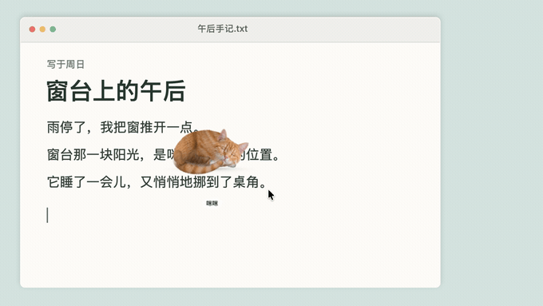

# Pawture · 爪影

Give Pawture one photo of your cat and it can curl up on your Mac desktop. Brush the sleeping cat's back with your pointer. It might stir, let out a little murmur, and go right back to sleep.

[Download for Mac](https://github.com/zh13662813127-code/Pawture/releases/latest) · [Watch the short film](https://zh13662813127-code.github.io/Pawture/) · [中文](README.md)

[](https://zh13662813127-code.github.io/Pawture/)

**Try it.** Unzip the preview on an Apple silicon Mac running macOS 14 or later and open `Pawture.app`. This preview is not notarized by Apple. The app interface is currently in Chinese. Two cats, Mimi and Baobao, are there on first launch.

- **Bring your own cat.** In 我的猫咪 (My Cats), press **＋**, select the new cat, then choose 更换照片 (Change Photo). Use a clear photo of one cat with its face and body visible. Adjust playfulness, affection, sleepiness, curiosity and independence.
- **Give them room.** Cats live over other apps, even after you close the control panel. Drag a cat to a new resting spot, or switch on click-through in the paw menu. Familiar cats sometimes touch noses or settle down together.
- **Offer to play.** Switch from 陪伴 (Companion) to 捣乱 (Mischief), wiggle the pointer near an awake cat and pause. It may stalk and pounce. Pawture does not move the system pointer or change what you type.



**How it works.** Apple Vision finds the outline and body landmarks locally. A shared 2D rig redraws each pose using texture from the photo. Parts the camera never saw, such as the belly, are approximations. No uploads, API keys or generated animation videos. Cats only for now.

**Build from source** with macOS 14+ and Swift 6:

```sh
git clone https://github.com/zh13662813127-code/Pawture.git
cd Pawture
Scripts/package-app.sh
open build/Pawture.app
```

[User guide and behavior references (Chinese)](docs/guide.zh-CN.md) · [Issues](https://github.com/zh13662813127-code/Pawture/issues) · [MIT license for code](LICENSE) · [Photo and media terms](docs/media-rights.md)
