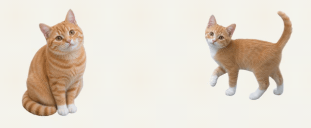

# Pawture · 爪影

**Keep a spot on your desk for the cat you miss.**

Have you ever come across a photo of your cat and reached out to stroke its head? Pawture is an open-source Mac app that gives that gesture somewhere to go. From one photo, your cat can curl up on your desktop while you write. Brush its back with the pointer. It might murmur and go right back to sleep.

[Watch *A Familiar Place in Your Day* · 38 seconds, English subtitles](https://zh13662813127-code.github.io/Pawture/?lang=en) · [Download for Apple silicon (macOS 14+)](https://github.com/zh13662813127-code/Pawture/releases/latest/download/Pawture-macOS-arm64.zip) · [Installation](#try-it) · [中文](README.md)

[](https://zh13662813127-code.github.io/Pawture/?lang=en)

This is what a digital keepsake means to us. A photo can hold the markings on a cat's forehead, but not its memories. You know which cat liked a nap and which one came looking for you. You can set those habits yourself.

## Try it

Unzip the Mac download, move `Pawture.app` into Applications, and open it. No Swift tools are needed. This preview is not notarized by Apple; see [Apple's guide to opening apps](https://support.apple.com/en-us/102445) if macOS blocks it, or build from source below. The app interface is in Chinese. Mimi and Baobao are there on first launch.

- **Bring your own cat.** In 我的猫咪 (My Cats), press **＋**, select the new cat, then choose 更换照片 (Change Photo). Use a clear photo of one cat with its face and body visible. Adjust playfulness, affection, sleepiness, curiosity and independence.
- **Give them room.** Cats live over other apps, even after you close the control panel. Drag a cat to a new resting spot, or switch on click-through in the paw menu. Familiar cats sometimes touch noses or settle down together.
- **Offer to play.** Switch from 陪伴 (Companion) to 捣乱 (Mischief), wiggle the pointer near an awake cat and pause. It may stalk and pounce. Pawture does not move the system pointer or change what you type.


**How it works.** Apple Vision finds the outline and body landmarks locally. A shared 2D rig redraws each pose using texture from the photo. Parts the camera never saw, such as the belly, are approximations. No uploads, API keys or generated animation videos. Cats only for now.

**Build from source** with macOS 14+ and Swift 6:

```sh
git clone https://github.com/zh13662813127-code/Pawture.git
cd Pawture
Scripts/package-app.sh
open build/Pawture.app
```

[Does a reaction feel wrong for your cat?](https://github.com/zh13662813127-code/Pawture/issues/new?template=cat-behavior.yml) Tell us what the cat was doing and what happened next. A written description is enough.

[User guide and behavior references (Chinese)](docs/guide.zh-CN.md) · [Other issues](https://github.com/zh13662813127-code/Pawture/issues) · [MIT license for code](LICENSE) · [Photo and media terms](docs/media-rights.md)
