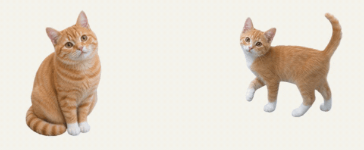
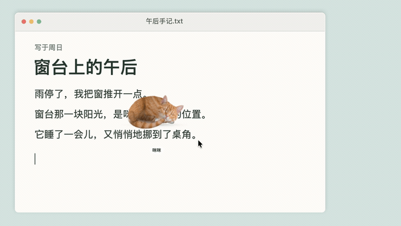

# 爪影 Pawture

**给想念的猫，在桌边留个位置。**

翻到它的照片时，你有没有下意识地伸手，想再摸摸它的头？

爪影是一个开源的 Mac 桌面宠物项目。选一张你家猫的照片，它就能带着那张熟悉的脸，在你写字时蜷在桌面一角。把鼠标沿着它的背轻轻划过，它也许只哼一声，接着睡。

[下载 Mac 试玩版](https://github.com/zh13662813127-code/Pawture/releases/latest) · [看介绍短片](https://zh13662813127-code.github.io/Pawture/) · [English](README.en.md)

[](https://zh13662813127-code.github.io/Pawture/)

*咪咪和宝宝是两只真实的猫。这里看见的动作，由爪影用它们各自的一张照片绘制。*

我们想做的「宠物赛博永生」，是把一点熟悉的日常留下来。一张照片留得住它额头的花纹，留不住它的记忆，也猜不出它从前有多黏人。那些你才知道的小习惯，可以由你慢慢调：让一只多睡一会儿，让另一只更喜欢过来蹭你。下次打开电脑，桌边还给它留着位置。

## 先和它们待一会儿

- **摸摸睡着的猫。** 把光标沿着背轻轻划过。它可能抬一下脸、轻哼一声；再摸一会儿，有时会翻出肚皮，有时醒来伸个懒腰。
- **看看另一只会不会回蹭。** 两只猫有时会凑近碰鼻、靠着打盹。对方也可以走开。想马上看一次，在控制面板选「猫咪互动 → 碰鼻蹭脸」。
- **拿鼠标当逗猫棒。** 默认是「陪伴」。切到「捣乱」，在一只醒着的猫旁左右晃几下再停住，它可能伏低、等一下，才扑向刚才的位置。它不会挪动系统光标，也不会改动你输入的字。
- **挡住字就抱走。** 按住猫身拖到别处，它会记住新的休息点。也可以在菜单栏的爪印里选「点击穿透桌面猫咪」，继续点猫身下的文档。



## 把自己的猫带来

1. 在 **macOS 14 或更新版本的 Apple 芯片 Mac** 上，从 [Releases](https://github.com/zh13662813127-code/Pawture/releases/latest) 下载试玩版，解压并打开 `Pawture.app`。预览版未经 Apple 公证；也可以按下方步骤从源码运行。
2. 第一次打开已有咪咪和宝宝。在「我的猫咪」点 **＋**，选中新增的猫，点「更换照片」。选一张只有这只猫、脸和身体轮廓都清楚的照片，成功率更高。
3. 调整它有多淘气、粘人、爱睡、好奇或独立，然后关掉控制面板。猫仍然在其他应用的窗口上活动。要再找面板，点菜单栏里的爪印。

## 一张照片怎么动起来

爪影用 Apple Vision 在本机提取猫的轮廓和身体关键点，再由 Swift 写的二维动作系统把原照的脸、毛纹和爪子摆进不同姿势。照片不上传，不需要 API 密钥，也不生成动作视频。**镜头没拍到的花纹和体型只能推算**；目前只支持猫。

### 从源码运行

需要 macOS 14+ 和 Swift 6 工具链。

```sh
git clone https://github.com/zh13662813127-code/Pawture.git
cd Pawture
Scripts/package-app.sh
open build/Pawture.app
```

[使用手册与行为依据](docs/guide.zh-CN.md) · [报告问题或提建议](https://github.com/zh13662813127-code/Pawture/issues)

代码使用 [MIT 许可证](LICENSE)。咪咪和宝宝的照片剪影、动图和短片另有[素材使用说明](docs/media-rights.md)。
